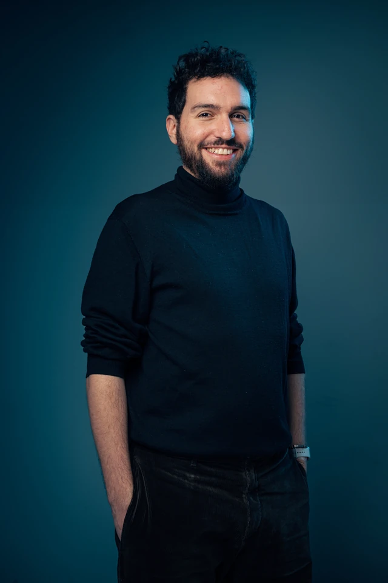
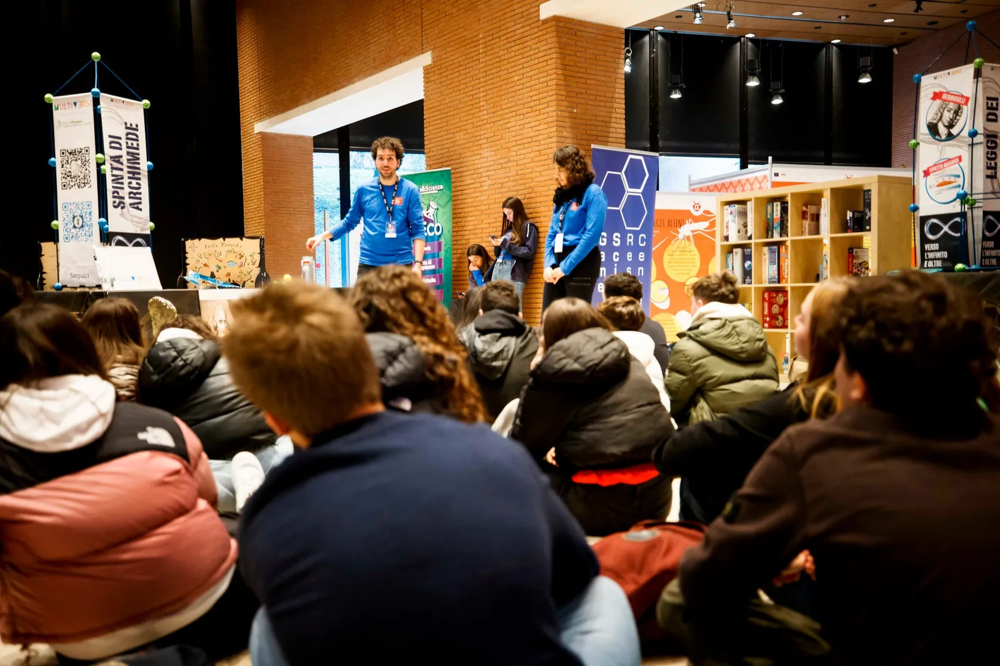
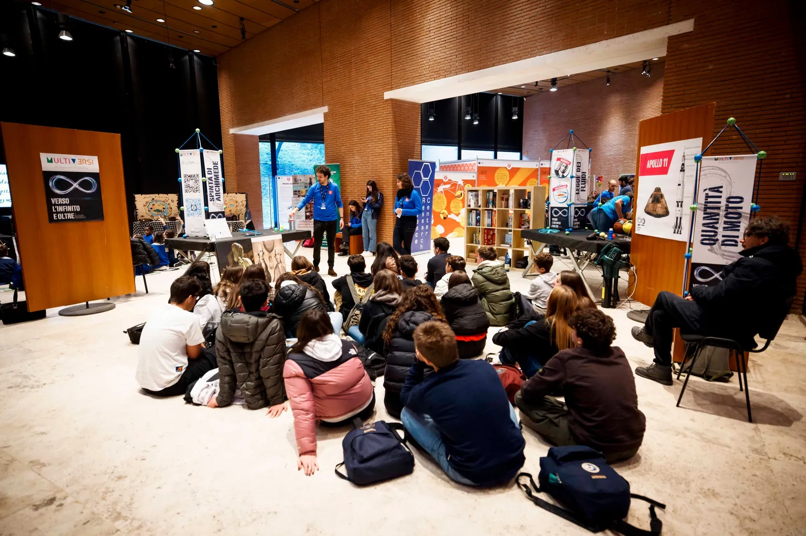
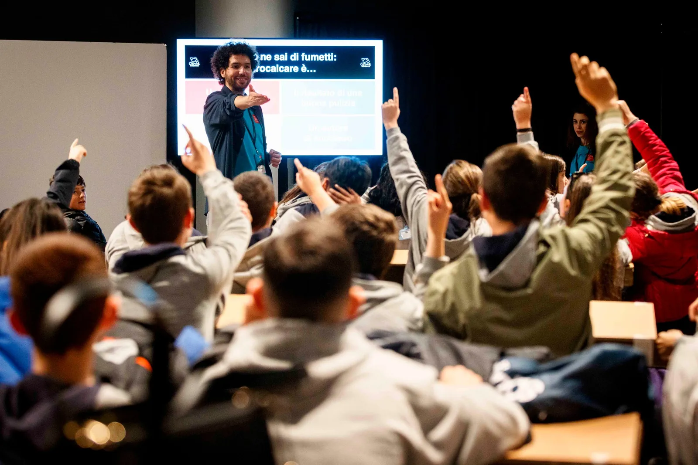
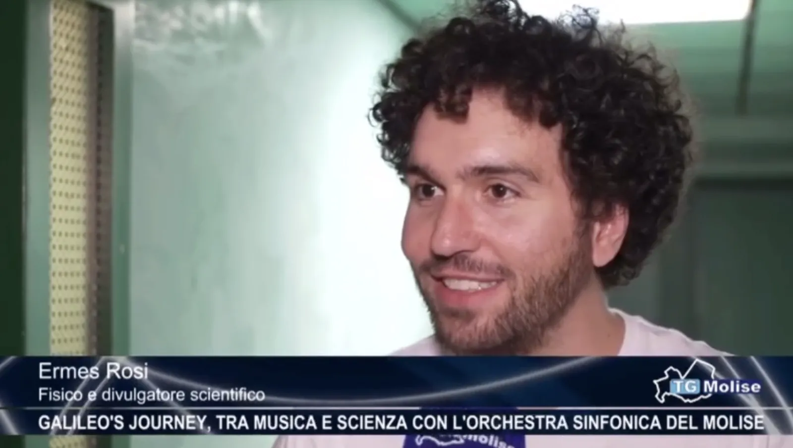
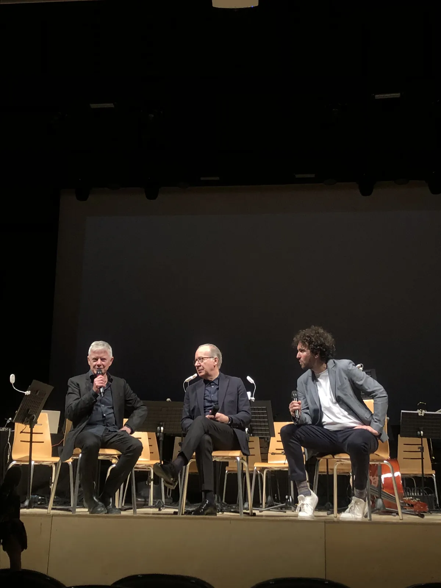
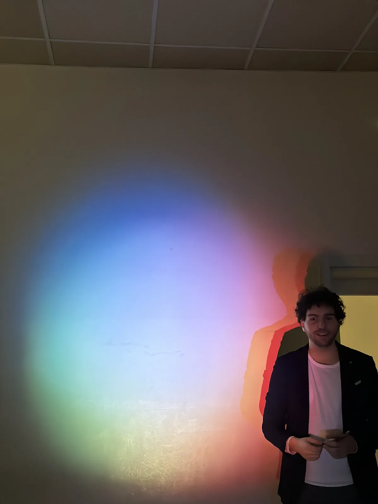
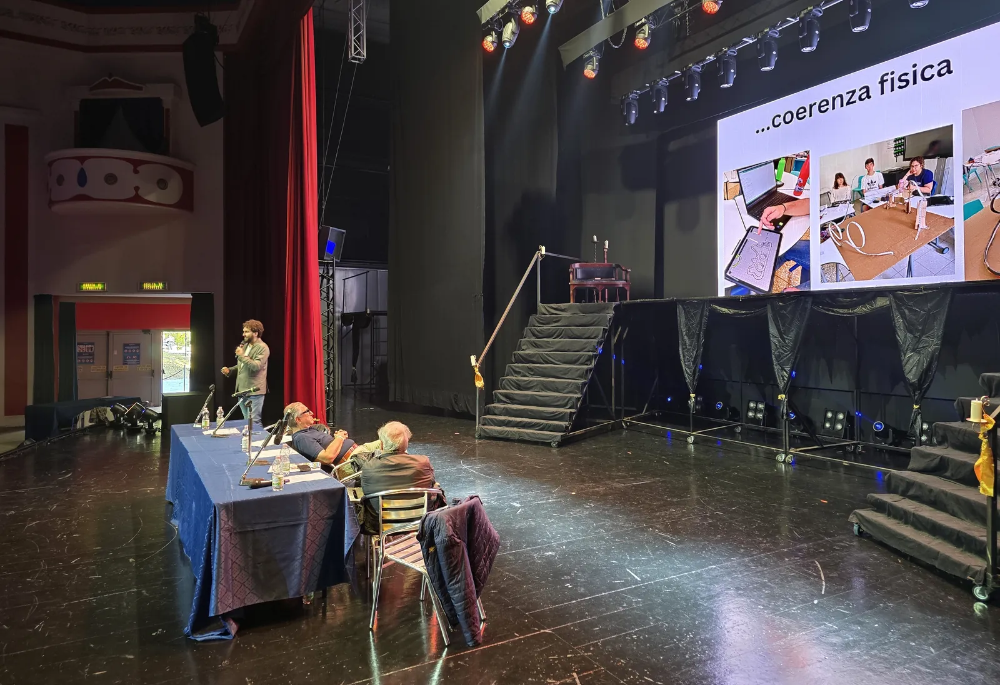
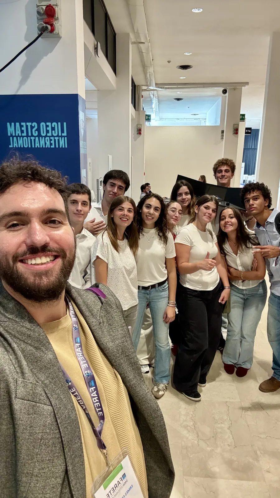
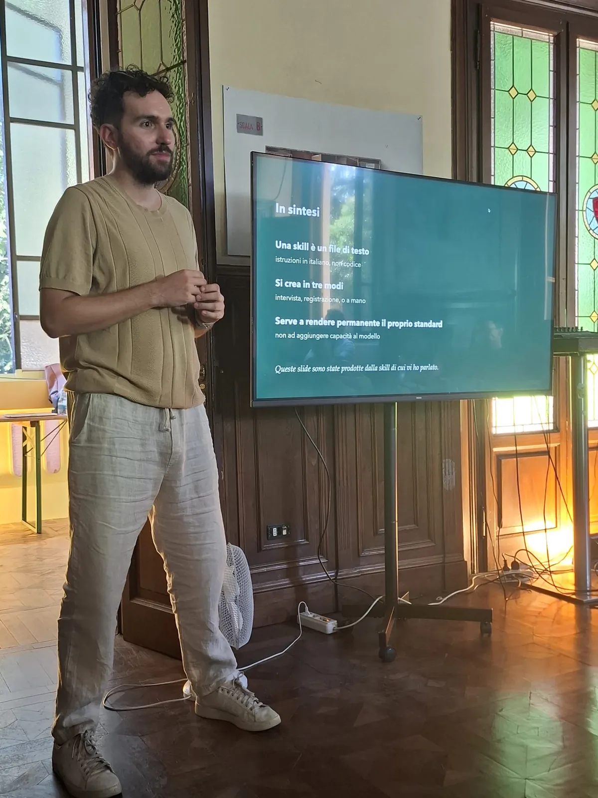

```{=html}
<figure class="ritratto"></figure>
```

Sono un astrofisico di formazione e insegno matematica e fisica al Liceo STEAM International di Bologna. Dopo la laurea magistrale, con una tesi in didattica della fisica, mi sono occupato di divulgazione scientifica e poi di insegnamento.

Considero la scienza una materia che necessita di un coinvolgimento attivo. Lo studente deve imparare a confrontarsi con sfide e problemi reali perché solo in questo modo imparerà a far parte del mondo, scegliendo con consapevolezza un futuro desiderabile. Per interiorizzare i metodi e gli strumenti propri dell'esplorazione scientifica, la mia metodologia didattica integra alla lezione tradizionale project-based learning, inquiry-based learning, microcontrollori e codice, portando la teoria dentro uno strumento da costruire per poter misurare il mondo.

Fuori dall'aula mi interessa la costruzione di una rete con gli stakeholder del territorio, al fine di esplorare il tessuto sociale che mi circonda.

Credo molto nel potere della comunicazione e dell'interattività. Da questo interesse nascono le mie slide e questo sito che le ospita: il non-luogo dove le mie idee diventano materia, cioè la mia didattica, la mia passione per le nuove tecnologie, le mie riflessioni sul mondo in cui vivo. Questo sito è per chi non ha mai smesso di essere curioso e cerca un luogo sicuro in cui esplorare il cosmo.

## Alcuni momenti {.unlisted}

```{=html}
<section class="carosello" aria-roledescription="carosello" aria-label="Momenti della mia vita professionale">
  <ul class="car-track" tabindex="0" aria-live="off" aria-label="Foto: usa le frecce della tastiera o scorri per cambiare">
    <li class="car-slide" role="group" aria-roledescription="foto" aria-label="1 di 9">
      <figure>
        <div class="car-frame"></div>
        <figcaption class="car-caption">
          <span class="car-title">Fisica del volo</span>
          <span class="car-meta">Festival delle Scienze, Auditorium Parco della Musica, Roma · 2022</span>
        </figcaption>
      </figure>
    </li>
    <li class="car-slide" role="group" aria-roledescription="foto" aria-label="2 di 9">
      <figure>
        <div class="car-frame"></div>
        <figcaption class="car-caption">
          <span class="car-title">Fisica del volo, il pubblico in sala</span>
          <span class="car-meta">Festival delle Scienze, Auditorium Parco della Musica, Roma · 2022</span>
        </figcaption>
      </figure>
    </li>
    <li class="car-slide" role="group" aria-roledescription="foto" aria-label="3 di 9">
      <figure>
        <div class="car-frame"></div>
        <figcaption class="car-caption">
          <span class="car-title">Comics &amp; Science</span>
          <span class="car-meta">Festival delle Scienze, Auditorium Parco della Musica, Roma · 2023</span>
          <span class="car-credit">Foto © Fondazione Musica per Roma – Musacchio, Ianniello, Pasqualini &amp; Fucilla</span>
        </figcaption>
      </figure>
    </li>
    <li class="car-slide" role="group" aria-roledescription="foto" aria-label="4 di 9">
      <figure>
        <div class="car-frame"></div>
        <figcaption class="car-caption">
          <span class="car-title">Intervista a TG Molise</span>
          <span class="car-meta">Il viaggio di Galileo, Campobasso · 2024</span>
        </figcaption>
      </figure>
    </li>
    <li class="car-slide" role="group" aria-roledescription="foto" aria-label="5 di 9">
      <figure>
        <div class="car-frame"></div>
        <figcaption class="car-caption">
          <span class="car-title">Il viaggio di Galileo</span>
          <span class="car-meta">Teatro Savoia, Campobasso · 2024</span>
        </figcaption>
      </figure>
    </li>
    <li class="car-slide" role="group" aria-roledescription="foto" aria-label="6 di 9">
      <figure>
        <div class="car-frame"></div>
        <figcaption class="car-caption">
          <span class="car-title">Luce e colori</span>
          <span class="car-meta">Lezione al Liceo STEAM International, Bologna · 2024</span>
        </figcaption>
      </figure>
    </li>
    <li class="car-slide" role="group" aria-roledescription="foto" aria-label="7 di 9">
      <figure>
        <div class="car-frame"></div>
        <figcaption class="car-caption">
          <span class="car-title">Innovazione didattica</span>
          <span class="car-meta">Convegno internazionale, Mirabilandia · 2025</span>
        </figcaption>
      </figure>
    </li>
    <li class="car-slide" role="group" aria-roledescription="foto" aria-label="8 di 9">
      <figure>
        <div class="car-frame"></div>
        <figcaption class="car-caption">
          <span class="car-title">Fiera Farete</span>
          <span class="car-meta">Bologna · 2026</span>
        </figcaption>
      </figure>
    </li>
    <li class="car-slide" role="group" aria-roledescription="foto" aria-label="9 di 9">
      <figure>
        <div class="car-frame"></div>
        <figcaption class="car-caption">
          <span class="car-title">Formazione docenti sugli strumenti AI</span>
          <span class="car-meta">Associazione Archilabò, Bologna · 2026</span>
        </figcaption>
      </figure>
    </li>
  </ul>
  <div class="car-controls">
    <button type="button" class="car-btn car-prev" aria-label="Foto precedente"><svg viewBox="0 0 24 24" aria-hidden="true"><path d="M15 5l-7 7 7 7"/></svg></button>
    <div class="car-dots">
      <button type="button" class="car-dot" aria-label="Vai alla foto 1 di 9"></button>
      <button type="button" class="car-dot" aria-label="Vai alla foto 2 di 9"></button>
      <button type="button" class="car-dot" aria-label="Vai alla foto 3 di 9"></button>
      <button type="button" class="car-dot" aria-label="Vai alla foto 4 di 9"></button>
      <button type="button" class="car-dot" aria-label="Vai alla foto 5 di 9"></button>
      <button type="button" class="car-dot" aria-label="Vai alla foto 6 di 9"></button>
      <button type="button" class="car-dot" aria-label="Vai alla foto 7 di 9"></button>
      <button type="button" class="car-dot" aria-label="Vai alla foto 8 di 9"></button>
      <button type="button" class="car-dot" aria-label="Vai alla foto 9 di 9"></button>
    </div>
    <button type="button" class="car-btn car-next" aria-label="Foto successiva"><svg viewBox="0 0 24 24" aria-hidden="true"><path d="M9 5l7 7-7 7"/></svg></button>
    <button type="button" class="car-btn car-toggle" data-state="playing" aria-label="Metti in pausa lo scorrimento automatico"><svg class="i-pause" viewBox="0 0 24 24" aria-hidden="true"><path d="M9 5v14M15 5v14"/></svg><svg class="i-play" viewBox="0 0 24 24" aria-hidden="true"><path d="M8 5l11 7-11 7z"/></svg></button>
  </div>
</section>
```
